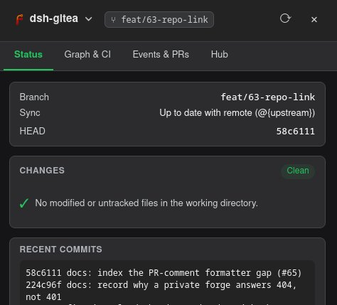

<div align="center">

# 🏴 dsh-gitea  

🇬🇧 **English** | 🇨🇳 [中文](README.zh.md) | 🇷🇺 [Русский](README.ru.md)

**Gitea/Forgejo, driven from your DeepSeek Harness session.**

Main repo on [pvlb.dev/dsh-plugins/dsh-gitea](https://git.pvlb.dev/dsh-plugins/dsh-gitea/)

96 first-class tools · preset-switchable surface · settings page · live Git status chip

[Install](#install) · [Configure](#configure) · [The toolset](#the-toolset) · [Safety](#safety-by-default) · [Development](#development) · [npm](https://www.npmjs.com/package/dsh-gitea)

</div>

---

## What it is

`dsh-gitea` connects a DeepSeek Harness session to your own Gitea or Forgejo
instance: the agent gets 96 first-class, schema-declared tools for issues, pull
requests, reviews, CI, releases and repositories (by default through the 2-tool
`dispatcher`, which serves each operation's schema on demand), and you get a
**Settings → Gitea** page plus a **Git status chip** in the session header.
Nothing is scraped from a web page — every call is a typed tool over the REST
API, with your token resolved from DSH credentials at call time.
Read a PR, review it, rebase it, watch its CI, tag the release and file the
follow-up issue without leaving the chat.

*A fork of [GooDAnDReaDY/dsh-gitea](https://github.com/GooDAnDReaDY/dsh-gitea)
(MIT) — see [Built on upstream](#built-on-upstream) for what this fork adds.*

## What you can do with it

- **Plan the work.** File one issue or fifty, with labels (by name *or* id),
  an assignee and a milestone in a single call; check for duplicates and lint
  the Definition of Done first; walk the chronological timeline before you
  answer; bulk-retag a backlog from a dry run you approved.
- **Read and change code with context.** Browse branches, tags, files, commits
  and diffs; search code locally when the forge API cannot; compare two refs
  before you merge them.
- **Review like a maintainer.** Inline comments with one-click suggestions,
  approve or request changes, and get a rule-based risk summary — areas
  touched, tests, migrations, merge state — plus a review inbox and reviewer
  suggestions from `CODEOWNERS` and commit history.
- **Merge safely.** A merge gate that checks description, conflicts,
  approval, tests and migrations; auto-merge only when the gate is green;
  stacked-PR chains with rebase helpers; conflict analysis that names the
  category of every hunk and can apply resolutions. Destructive steps need
  `confirm: true`; the rest are dry runs first.
- **Ship it.** Conventional-Commits release planning, semver validation,
  changelog drafts, tags, releases, CI run inspection with log root-cause
  analysis, and the package registry (npm, PyPI, OCI, generic) with
  ready-to-paste client config.
- **Run the project.** Health reports, a daily triage digest, a duty-officer
  snapshot, scheduled read-only checks, branch protection, deploy keys, a
  security audit, and webhooks you can replay offline.
- **Work where the repo lives.** Git worktrees for isolated branches, a
  commit graph in the UI, and an issue → branch → worktree → PR flow that
  keeps the issue and the code in sync.

<div align="center">



*The Git drawer — repository link, branch, sync state, changes and recent commits.*

</div>

## Requirements

- DeepSeek Harness `0.2.x` — the `0.2.0` and `0.2.1` prerelease lines are both
  in the package's peer range.
- Node.js 20 or newer.
- `pnpm` that DSH can execute — Plugin Manager shells out to it for profile
  installs.
- `git` on the DSH host for the git install (the tarball fallback does not
  need it).
- A Gitea or Forgejo instance reachable over HTTPS from the DSH host, plus an
  API token for it.

## Install

One command on the DSH host. This is the whole install:

```bash
dsh plugin --profile web add dsh-gitea
```

`web` is the profile name; use your own if you launch DSH with
`--profile <name>`. The package is published to the public npm registry as
[`dsh-gitea`](https://www.npmjs.com/package/dsh-gitea).

The command adds `dsh-gitea` to the profile and selects its bundle — the package
declares `dsh.bundle`, so the plugin row is enabled without a separate Plugin
Manager step. There is no checkout to bootstrap, and `npm run dev:link` is
**not** needed: that script only exists for `link:` installs of a working copy.

DSH applies the new profile by itself — in the web profile HMR watches the
bundle list; on a profile without HMR, restart the DSH service. Refresh the
browser tab afterwards.

### Install straight from the repository

Rolling `master`:

```bash
dsh plugin --profile web add https://git.pvlb.dev/dsh-plugins/dsh-gitea.git
```

Pinned to a release tag:

```bash
dsh plugin --profile web add https://git.pvlb.dev/dsh-plugins/dsh-gitea.git#v0.8.4
```

The `.git` suffix is what makes pnpm treat the URL as a git repository. Without
it the URL is fetched as a tarball and the install fails with
`ERR_PNPM_TARBALL_HTTP_STATUS … 404`.

### Fallback — the Forgejo registry tarball

Use this when neither npmjs nor the git remote is reachable from the DSH host:

```bash
dsh plugin --profile web add https://git.pvlb.dev/api/packages/dsh-plugins/npm/dsh-gitea/-/0.8.4/dsh-gitea-0.8.4.tgz
```

Either way the package is self-contained — `lib/index.js` plus
`cordis.patch.yml` — and its DSH peers come from the profile.

## Configure

Two settings are all that matter; the rest of the page can stay default.

1. **Instance URL.** Open **Settings → Gitea** — or **Plugins → dsh-gitea →
   Configure** — and set `baseUrl`, for example `https://git.example.com`.
2. **Token.** In Forgejo/Gitea open **Settings → Applications → Generate token**
   with the repository, issue and pull-request scopes (`read:user` covers
   `gitea_whoami`). Then store the secret in DSH credentials under the name the
   form expects — `GITEA_TOKEN`, unless you changed `tokenEnv`.

   The store is the hidden file `~/.dsh/.credentials.yaml`; its top level is
   `version: 1`, then `records:` and `refs:`. Add the name under `refs:`:

   ```yaml
   refs:
     GITEA_TOKEN: <the token you just generated>
   ```

   If the file already exists, merge that one line into its `refs:` block and
   leave the rest alone. A new file needs `version: 1` followed by the block
   above. Other DSH key editors write to the same store, so this file is simply
   the direct route for a name nothing else manages.

The settings form takes the credential **name**, never the token — a token-shaped
value is refused. DSH's credential store reloads this file on change and resolves
the secret per call, so a new or rotated token applies to the next tool call
without a restart.

Optional: set `defaultOwner` and `defaultRepo` so tools that omit `owner`/`repo`
fall back to your usual repository.

### Tool surface — keep the payload small

Every registered tool's schema is bound into every request, so the plugin has a
preset switch. **The default is `dispatcher`** (since 0.8.9): two meta-tools that
keep all 96 operations reachable while the always-on payload stays ~8.5 KB
instead of ~60 KB. Set `preset: full` — in the config or the settings dropdown —
when you want the 96 typed tools as first-class functions, and narrow further
when a workspace only files issues or only reviews pull requests.

```yaml
- id: dsh-gitea
  config:
    preset: dispatcher  # dispatcher (default) | core | issues | prs | repos | ops | full | none | custom
    tools: []           # glob allowlist; non-empty replaces the preset
    excludeTools: []    # patterns removed after the preset/allowlist
    legacyAliases: false
```

| Preset | Tools | Schema bytes | ≈ tokens |
|:--|--:|--:|--:|
| `dispatcher` (default) | 2 | 8,973 | ~2.4k |
| `full` | 96 | 65,159 | ~17.6k |
| `core` | 15 | 11,640 | ~3.1k |
| `issues` | 22 | 15,586 | ~4.2k |
| `prs` | 27 | 17,480 | ~4.7k |
| `repos` | 17 | 12,026 | ~3.3k |
| `ops` | 30 | 20,067 | ~5.4k |
| `none` | 0 | 0 | 0 |
| `full` + `legacyAliases` | 133 | 107,157 | ~29k |

- `core` is the 15 hot tools; the domain presets are disjoint and their union is
  `full`. `*` is the only wildcard, and a pattern that matches nothing is
  reported in the settings form and the log instead of being ignored silently.
- `legacyAliases` (default **off** since 0.8.5) re-advertises the 37 pre-0.8
  alias names. They duplicate their canonical schema, so they cost ~42 KB of
  payload; an alias call still resolves even when it is not advertised.
- Saving a different surface re-registers the tools immediately (no restart).
  `preset: none` is for workspaces where the agent should not see Gitea tools.
- `dispatcher` was the opt-in preset in 0.8.6–0.8.8 and is the **default since
  0.8.9**. Two meta-tools, `gitea { operation, args }` and `gitea_help {
  operation }` (which returns one operation's JSON Schema as a tool result). The
  registry is **stable** — no dynamic registration — so the request prefix stays
  cacheable, and every operation is still reachable; `preset: full` swaps back to
  the typed surface in one line. Configs that already saved a preset keep their
  value, so the flip only reaches installs that never chose one.
  The trade-off is measured, not theoretical: on five real triage tasks (2026-10)
  a step cost 41.1k tokens instead of 58.2k (−29 %), but the agents needed
  +30 % steps (help round trips and argument-name retries), so the **total** was
  only ~8 % lower and cost-weighted (cache hit ≈ 0.26× fresh) roughly level.
  Expect a wash on short tasks and a modest win past ~10 steps; it is **not** a
  magic token saver (#51). Unknown arguments come back as a clear error naming
  the accepted ones, which is why retries are cheap.

## Verify

- **Settings → Gitea** exists and lists fields; **Plugins** lists `dsh-gitea`
  with a **Configure** page. `plugin_manager action=list_bundles` shows the row
  and whether it is enabled.
- Ask the agent to run **`gitea_whoami`**. It returns the Forgejo user behind
  your token, which proves `baseUrl`, the credential and the token scopes in one
  call.
- Open a session in a git workspace: a **Git chip** appears in the session header.

## Troubleshooting

| Symptom | Cause | Fix |
|:--|:--|:--|
| `ERR_PNPM_TARBALL_HTTP_STATUS … 404`, or a JSON parse error, while adding | the URL had no `.git`, so pnpm fetched it as a tarball | append `.git`, or install the tarball URL above |
| `spawn pnpm ENOENT`, or `dsh: pnpm was not found` | the DSH service's `PATH` has no `pnpm` | name it in the profile patch — `plugin-manager.pnpmCommand: /opt/node/bin/pnpm` (your absolute path) — then retry |
| The row reports `failed to import` or `Cannot find package '@deepseek-ai/schemastery'` | a `link:` install of a working copy without peer resolution; a git or tarball install does not do this | run `npm run dev:link` in that checkout, then toggle the bundle off and on |
| No **Gitea** entry under Settings | the bundle is not selected, or the browser still runs the old client bundle | check `plugin_manager action=list_bundles`, hard-refresh (`Ctrl+F5`), restart DSH if the profile has no HMR |
| Tools answer `401`/`403` although the form shows a credential name | that credential does not exist, or the token lacks scopes | create it under `refs:` with the exact `tokenEnv` name; regenerate the token with repository, issue and pull-request scopes |
| `403` from the Gitea page over a LAN/Tailscale hostname | a pre-0.8 build whose request guard fell back to loopback-only | upgrade to 0.8.1 or newer, then reload the Host half |

## The toolset

**96 first-class tools** (all advertised by the `full` preset — the default
`dispatcher` preset reaches every one of them through its two meta-tools) plus
**37 compatibility aliases** that are opt-in since 0.8.5. Repository-scoped tools
take optional `owner`/`repo` (falling back to
`defaultOwner`/`defaultRepo`, then to the session's git origin), and every
tool accepts an `instance` selector for multi-instance setups. Destructive
tools require `confirm: true` and the riskier helpers are dry-run-first, so an
agent can preview before it writes: nothing merges, deletes or pushes by
accident.
The 37 aliases are the older single-action names (`gitea_ci_status`,
`gitea_label_list`, `gitea_release_create`, …); each maps to one canonical
tool plus a default action, so existing prompts and scripts keep working.

| Area | Tools | What it covers |
|:--|--:|:--|
| Plan: issues, labels, milestones | 22 | filing, triage, templates, duplicates, bulk ops, issue → PR |
| Review and merge | 27 | PRs, inline review with suggestions, merge gates, rebase, stacks, conflicts |
| Repository and history | 11 | branches, tags, file bodies, commits, compare, search, mirror status |
| Operations and governance | 17 | health, triage digests, scheduled checks, branch protection, webhooks, org, wiki, users |
| Local git and worktrees | 7 | worktrees, commit graph, action cards |
| Ship | 12 | releases, semver and changelogs, CI runs and log analysis, packages, syncs, incidents |

### Plan: issues, labels and milestones — 22 tools

*The whole planning surface: file, triage, and keep a backlog honest.*

- **`gitea_issue_list`** — issues by state with explicit paging; no silent
  row cap.
- **`gitea_issue_get`** — one issue, optionally with its comments.
- **`gitea_issue_create`** — title, body, labels (names or numeric ids),
  assignee and milestone in one call.
- **`gitea_issue_update`** — edit title, body or state.
- **`gitea_issue_close`** — close an issue in one step.
- **`gitea_issue_comment`** — add a comment.
- **`gitea_issue_comments`** — list comments, each flagged `mine: true/false`.
- **`gitea_issue_comment_delete`** — delete your own comment; dry run unless
  `confirm: true`.
- **`gitea_issue_search`** — instance-wide search filtered by repo, state,
  type or labels.
- **`gitea_issue_set_assignee`** — hand an issue to a login.
- **`gitea_issue_timeline`** — comments, events and status transitions in
  chronological order.
- **`gitea_issue_lint`** — pre-flight check for problem, impact, priority,
  DoD, boundaries, dependencies and verification sections; advisory only.
- **`gitea_issue_duplicates`** — rank likely duplicates by title/body
  similarity before you file.
- **`gitea_batch_issue_ops`** — set label, assignee or milestone on many
  issues; dry run unless confirmed.
- **`gitea_issue_templates`** — list and validate the Gitea YAML issue forms
  (the plugin ships a house set; you can point it at another directory).
- **`gitea_issue_flow`** — plan a branch name and worktree path for an issue,
  or open the PR from a head branch.
- **`gitea_issue_to_pr`** — run the issue → branch → worktree → PR cycle, with
  worktree creation and PR creation behind flags.
- **`gitea_labels`** — list, create, delete, set on an issue, or add; the list
  shows the numeric ids the other actions consume.
- **`gitea_label_bootstrap`** — idempotently sync the pvlb.dev house label set
  (or the legacy "upstream" taxonomy); dry run unless applied, never deletes
  foreign labels.
- **`gitea_label_auto`** — preview the workflow actions an issue's labels
  imply; read-only.
- **`gitea_milestones`** — list, create, update and delete milestones,
  including due dates.
- **`gitea_reactions`** — list, add or delete emoji reactions on issues and
  comments.

### Review and merge: pull requests, reviews and gates — 27 tools

*From "what does this PR do" to a merged, rebased branch — with the safety
rails an autonomous agent needs.*

- **`gitea_pr_list`** — open, closed or all PRs.
- **`gitea_pr_get`** — one PR by number, merged state included.
- **`gitea_pr_create`** — open a PR from head to base.
- **`gitea_pr_comment`** — conversation comment on a PR.
- **`gitea_pr_diff`** — unified diff, or file-level `+/-` statistics.
- **`gitea_pr_files`** — the changed-file list with paging.
- **`gitea_pr_line_comment`** — inline diff comment with an optional
  suggestion block for one-click commit.
- **`gitea_pr_reviews`** — the review history of a PR.
- **`gitea_pr_submit_review`** — submit `APPROVED`, `REQUEST_CHANGES` or
  `COMMENT`.
- **`gitea_pr_review`** — hybrid rule-based review: areas, tests, migrations,
  merge state, verdict and open questions; read-only.
- **`gitea_ai_review`** — automated pass over the diff (secrets, path
  traversal, conventional commits) with structured findings, optionally
  posted to the PR.
- **`gitea_review_inbox`** — triage: awaiting my review, mine awaiting
  review, merge-ready.
- **`gitea_review_escalate`** — find high-priority PRs waiting more than N
  days without review and optionally ping reviewers; dry run by default.
- **`gitea_suggest_reviewers`** — reviewer suggestions from `CODEOWNERS` and
  git contributor history.
- **`gitea_pr_merge_status`** — is this PR mergeable right now?
- **`gitea_merge_readiness`** — the checklist gate: description, conflicts,
  approval, tests, migrations; it never merges.
- **`gitea_pr_summary`** — change and risk summary for one PR.
- **`gitea_pr_impact`** — impact map: files, areas, correctly sourced issue
  references, author, state.
- **`gitea_auto_merge`** — merge only when the whole gate is green; requires
  `confirm: true`.
- **`gitea_pr_merge`** — merge, rebase or squash; requires `confirm: true`.
- **`gitea_pr_rebase`** — rebase a PR branch onto fresh `main`; dry run by
  default.
- **`gitea_pr_stack_status`** — stacked-PR dependency chains and rebase
  readiness.
- **`gitea_pr_stack_rebase`** — rebase a stacked child onto the updated base
  after its parent merged.
- **`gitea_conflict_analyze`** — 3-way conflict analysis that categorizes
  each hunk (imports, dependencies, formatting, comments, semantic) and
  suggests resolutions.
- **`gitea_pr_conflict_resolve`** — apply per-file resolutions and commit;
  dry run preview by default.
- **`gitea_pr_template_check`** — check a PR body against the template
  sections and whether the risk checklist applies.
- **`gitea_pr_policy`** — read and validate `.gitea/pr-policy.yml`, optionally
  against a changed-file list.

### Repository and history: branches, tags, files, search — 11 tools

*Everything the agent needs to look at code before it changes code.*

- **`gitea_branches`** — list, create and delete branches.
- **`gitea_tags`** — list, create and delete tags.
- **`gitea_repo_contents`** — decoded file body (capped at 20 KB with a
  download link) or a directory listing; an empty path lists the root.
- **`gitea_repo_commits`** — commits for a branch or SHA, with paging.
- **`gitea_repo_compare`** — compare `base...head`.
- **`gitea_repo_search`** — search repositories on the instance.
- **`gitea_code_search`** — real `git grep` in the workspace, because the
  Gitea REST API has no server-side code search.
- **`gitea_repo_bootstrap`** — scaffold a repository from a safe template
  (README, gitignore, CI, issue/PR templates); dry run by default.
- **`gitea_repo_analytics`** — open/closed issue counts, PR metrics and
  average cycle time; read-only.
- **`gitea_mirror_public`** — a public-mirror plan (sanitize history, push
  steps); read-only, it never pushes.
- **`gitea_mirror_sync_status`** — mirror lag and sync status, or trigger a
  sync with `confirm: true`.

### Operations and governance — 17 tools

*Keep the project healthy, not just the current branch.*

- **`gitea_project_health`** — open PRs, open and stale issues, stale
  branches, API errors.
- **`gitea_triage_digest`** — a daily digest with one priority action.
- **`gitea_duty_report`** — duty-officer snapshot, including PRs new since
  `lastCheckAt`.
- **`gitea_scheduled_checks`** — register, list and run recurring read-only
  checks (health, triage, inbox) with recent run history.
- **`gitea_branch_protection_get`** — the protection rules in force.
- **`gitea_branch_protection_set`** — require reviews/approvals, block force
  pushes, require status checks; requires `confirm: true`.
- **`gitea_security_audit`** — protection status, force-push policy and review
  requirements in one read-only report.
- **`gitea_deploy_keys`** — list, add and delete repository deploy keys;
  requires `confirm: true`.
- **`gitea_webhooks`** — list, create and delete repository webhooks (JSON,
  form or multipart payloads, chosen events).
- **`gitea_webhook_sandbox`** — inspect buffered incoming webhooks, replay an
  event, or clear the buffer without touching the forge.
- **`gitea_org`** — organization repos, members and teams, plus private
  repository creation.
- **`gitea_wiki`** — list, read metadata, create, update and delete wiki
  pages; page bodies live in `<repo>.wiki.git`, so `get` is metadata-only.
- **`gitea_notifications`** — the authenticated user's notification list.
- **`gitea_notifications_mark_read`** — mark them read; requires
  `confirm: true`.
- **`gitea_user_search`** — find users on the instance.
- **`gitea_whoami`** — which user the configured credential belongs to.
- **`gitea_flavor`** — Gitea or Forgejo, detected from `/version`, with the
  feature differences that matter.

### Local git and worktrees — 7 tools

*The bridge between the chat's working directory and the forge.*

- **`gitea_worktree_list`** — the worktrees of the working copy.
- **`gitea_worktree_add`** — create a worktree for an existing or new branch
  (write operations use the configured git wrapper).
- **`gitea_worktree_use`** — pin the session's git header to a worktree.
- **`gitea_worktree_remove`** — remove a worktree; requires `confirm: true`.
- **`gitea_worktree_gc`** — find merged or abandoned worktrees and prune the
  verified ones; dry run until you pass `prune` and confirm.
- **`gitea_git_graph`** — topological commit graph with lanes, branch/tag
  refs and optional CI statuses per commit.
- **`gitea_action_card`** — a Generative-UI action card for an issue, PR or
  branch whose buttons dispatch through the plugin's Hub endpoint.

### Ship: releases, CI and packages — 12 tools

*Cut the release, then prove it went out clean.*

- **`gitea_releases`** — list, create, update and delete releases, plus
  release-plan and release-notes actions.
- **`gitea_release_plan`** — Conventional Commits history → SemVer bump and a
  structured changelog draft.
- **`gitea_release_assistant`** — validate a semver, preview notes, or run
  preflight checks for a release.
- **`gitea_ci`** — CI runs, a single run, its jobs, a job's log, reruns, and
  an explain action; reruns require `confirm: true`.
- **`gitea_ci_logs_analyze`** — root-cause line and fix recommendations from a
  failed run, job or raw log text.
- **`gitea_packages_list`** — published packages (npm, PyPI, OCI/Docker,
  generic) filtered by owner, repo or a search query.
- **`gitea_package_get`** — one package's versions and metadata.
- **`gitea_package_delete`** — delete a version; requires `confirm: true`.
- **`gitea_package_config`** — a paste-ready client snippet (`.npmrc`,
  `pip.conf`, `docker login`) for the registry.
- **`gitea_task_tracker_sync`** — export, convert and sync issue cards with a
  DSH Task-Tracker board (`dsh-drives.task-provision.v1`).
- **`gitea_memory_brain_sync`** — index releases, merged PRs and decisions as
  Memory Brain facts.
- **`gitea_incident_report`** — turn crash logs or alerts into a sanitized
  incident issue from `incident.yaml`; dry-run preview available.

## Beyond the tools

**A settings page that actually persists.** **Settings → Gitea** is a
first-class page, and the same form is reachable from
**Plugins → the bundle row → Configure**. It covers the connection, the
credential *name*, defaults, timeouts, proxy URL rewriting, the webhook
secret, push notifications, the background scheduler, the DoD reminder, extra
instances and the update switch. The form is backed by `GET`/`POST
/dsh-gitea/config`, reports whether it is writable instead of disappearing on
remote pages, and only ever accepts a credential reference — never a token.

**A Git chip where you are already looking.** The session header shows the
branch, a dirty marker, ahead/behind counts, the open PR number, `CI✗` when
its checks fail, and a mirror-lag warning. One click opens a drawer with four
tabs: **Status**, **Graph & CI** (commit graph with per-commit CI statuses),
**Events & PRs** (live event feed and PR context) and **Hub**. The drawer
header starts with the **Gitea or Forgejo logo and the repository name as one
link** to the repository's web page — the URL comes from the checkout's
`origin` remote, and the icon (Forgejo, Gitea or hidden) is a setting.

**Webhooks in, events out.** Point a Gitea/Forgejo webhook at
`POST /dsh-gitea/webhook` and the payload is verified with HMAC-SHA256 using
the credential named in `webhookSecretEnv` — no secret means 401, not a
processed payload. Accepted events land in an in-memory ring of the last 50,
are readable at `GET /dsh-gitea/events`, and stream to the browser over SSE at
`GET /dsh-gitea/sse`. An optional `notifyWebhook` forwards new-PR and
failed-CI alerts to an external channel.

**A Hub for the UI's buttons.** `GET /dsh-gitea/hub` aggregates issues, PRs,
CI runners and worktrees for the drawer; `POST /dsh-gitea/hub` dispatches the
actions the UI and the action cards use: approve, merge, close, open/switch a
worktree, garbage-collect worktrees, CI log analysis, stacked-PR inspection
and conflict resolution. Every branch of it sits behind the same
Host/Origin/Connection fence as the rest of the routes.

**Issue templates, shipped.** Seven Gitea YAML issue forms come in the box
(bug, feature, tech-debt, security, incident, research, config-change) and the
template tool validates that a form still has the fields Gitea needs before
you publish it. The repository bootstrap tool plants the same pack in new
repositories.

**Review and hand-off flows.** An issue can be planned into a branch and
worktree, turned into a PR draft, and handed back to the review inbox. The PR
review is rule-based and read-only unless you ask for comments; the AI review
only posts when told to.

**Background triage, off by default.** Enable the scheduler and it runs a
triage digest on an interval, posts it to an optional webhook, and does a
dry-run worktree garbage-collection inspection — nothing is deleted. The
DoD reminder (also off by default) appends a non-blocking note when a tool run
changed git files without referencing an issue or PR.

**Services other plugins can compose.** `dshGitea` implements the
`dsh-drives.task-provision.v1` contract (`isConfigured()`, `createIssue()`,
idempotent by `externalRef`, resolving label names on the way through) so a
task board can spawn Gitea issues. `giteaEvents` is the fan-out for webhook
events (`subscribe`, `on('event')`, `emit`, `subscriberCount`), so a second
plugin can react to forge activity without polling.

## Safety by default

- **The token never lives in the plugin.** The form and the config hold a
  credential *name*; DSH resolves the secret at call time. A token-shaped value
  is rejected, and nothing secret is written to the repository or a log.
- **Every custom route is fenced.** `lib/http-guard.js` delegates to the DSH
  Connection when one is mounted (401 for an unauthenticated remote client,
  403 for a rejected origin) and otherwise falls back to loopback-only,
  fail-closed.
- **Webhooks are authenticated.** `POST /dsh-gitea/webhook` verifies an
  HMAC-SHA256 signature; a missing secret answers 401 instead of processing the
  payload.
- **Risky writes are gated.** Destructive tools need `confirm: true` (the
  riskier helpers are dry-run-first), and the one-click updater needs both a
  loopback request carrying `x-dsh-plugin-update` and the `updates` switch.
- **The publishable tree is scanned.** `npm run test:leaks` fails the build on
  private paths, private scopes, token literals or Cyrillic text in shipped JS.

## Built on upstream

`dsh-gitea` is a fork of
[`GooDAnDReaDY/dsh-gitea`](https://github.com/GooDAnDReaDY/dsh-gitea) (MIT),
branched at upstream `abfd952` and maintained on the pvlb.dev forge. We run it
on our own DeepSeek Harness deployment and carry the fixes and deployment glue
it needed.

**Upstream is watched, not developed against.** Its public GitHub tree is
generated from the author's private source repo — every commit is
`chore(publish): sanitized tree from <sha>` — so a PR against generated files
(such as `lib/client.js`) can be dropped on the next publish. We sync
deliberately when an upstream change matters, keep the patch set small, and send
improvements upstream as minimal, portable patches when they make sense
(`lib/http-guard.js` is the cleanest candidate).

What the fork adds on top of upstream:

| Change | Why |
|:--|:--|
| `settings.section` registration (`Settings → Gitea`) | upstream's `settings.plugin.item` seat was removed in DSH 0.2.x and rendered nowhere |
| Route-backed settings form (`GET`/`POST /dsh-gitea/config`) with `writable` + Retry | the browser `configForms` mirror is memory-only on non-loopback pages and hid every field |
| `lib/http-guard.js`: a mounted DSH Connection fence is authoritative for reads and writes | admitted Tailscale/LAN requests fell through to the loopback-only fallback and became `403` |
| `scripts/dev-link-dsh.mjs` (`npm run dev:link`) | pnpm `link:` installs do not resolve the plugin's DSH peers |
| `updates` Config switch + an updater pointed at the Forgejo npm registry | the updater installs **our** published package, not upstream's; the switch protects a `link:` dev checkout |
| `test/` regression suite + `scripts/leak-scan.mjs` | upstream's public tree ships the `npm test` script but not the test files |
| `.forgejo/workflows/ci.yml` + `publish.yml` | checks on every push to `master`; tagged publishes go to our own npm registry |
| Unscoped `dsh-gitea` package name, version tags, this README + `AGENTS.md` | the fork is a maintained project, not an anonymous snapshot |

Tool fixes carried in the fork: output formatters (row truncation, bare `OK`,
label ids), wiki CRUD and repo-contents decoding, PR/merge semantics, the
issues #19–#38 QA sweep over the tool surface, and the issue #44 updater
symlink fix in `0.8.1`.

## Development

```bash
npm run dev:link    # node scripts/dev-link-dsh.mjs
```

`plugin_manager` installs a local checkout as a pnpm `link:` dependency, and
pnpm does not resolve a linked package's peers from the target directory. The
script locates the running DSH install (argument, `$DSH_PACKAGE_DIR`, or the
`dsh` executable) and symlinks the packages this plugin imports into the
gitignored `node_modules/`; it never writes to the DSH install. A registry or
git install needs none of this.

After a change, reload the half you touched:

- **Host half** (`lib/index.js`, routes, handlers): toggle the bundle off and on
  (`plugin_manager action=set_bundle`), or opt the checkout into HMR in the
  **profile** patch (`<profile>/cordis.patch.yml`, outside this repo):

  ```yaml
  - id: hmr
    config:
      root: ["/path/to/dsh-gitea"]
  ```

  With that root, Host edits reload without restarting `dsh web`.
- **Client half** (`lib/client.js`): the bundle is served per request, so a hard
  refresh (`Ctrl+F5`) picks it up.

Checks — `npm run check` is the CI gate and what to run before every push:

```bash
npm run check        # npm test && test:leaks && node --check lib/client.js + lib/index.js
npm test             # node --test test/*.test.mjs
npm run test:leaks   # publishable-tree hygiene: private paths/scopes/token literals/Cyrillic
```

Two caveats:

- `lib/client.js` is generated output — a single
  `window.__ModuleLoader__.load({ id, factory })` browser bundle, not source.
  Edits there are intentional source patches; upstream regenerates that file
  from private TypeScript, so expect merge conflicts there on sync (it is our
  largest diff) and re-apply our block.
- There is no browser automation here. A green `npm run check` proves syntax
  and registration, not what a human sees; UI changes still need a human check
  in the Web UI (Settings entry, fields, save persistence, Git chip).

## CI, releases and versioning

Four Forgejo Actions workflows in `.forgejo/workflows/`:

| Workflow | Trigger | Does |
|:--|:--|:--|
| `ci.yml` | push to `master`, manual dispatch | Node 22.6 → `npm run check`, then `npm pack --dry-run` |
| `publish.yml` | tag `v*` (manual = dry run) | re-runs the checks, requires the tag to equal `v<package.json version>`, publishes to the Forgejo registry, skips an already-published version |
| `publish-npmjs.yml` | tag `v*` (manual = checks only) | the same checks and tag guard, then `npm stage publish` to the public npm registry; skipped while the `NPMJS_TOKEN` secret is absent |
| `release.yml` | tag `v*` (manual = notes preview) | creates the Forgejo release page for the tag: name and notes from `CHANGELOG.md`, plus the npm tarball as a downloadable asset; never rewrites an existing release |

- Release pages are generated, not hand-written: `scripts/release-notes.mjs`
  turns the `## [<version>]` changelog section into the title
  (`v0.8.4 — Publish to npmjs through staged publishing`) and body, and appends
  the install command for that exact version. The workflow uses the automatic
  Actions token (a `RELEASE_TOKEN` secret overrides it) and leaves an existing
  release untouched, so notes edited in the UI survive later re-runs. The same
  page carries the tarball:
  `.../releases/download/v<version>/dsh-gitea-<version>.tgz`.

- Registries: the Forgejo one is
  `https://git.pvlb.dev/api/packages/dsh-plugins/npm/` (secret `NPM_TOKEN`, a
  Forgejo token with the `write:package` scope); npmjs is the default registry
  (secret `NPMJS_TOKEN`, a granular token with *read and write (stage only)*).
  An empty `NPM_TOKEN` fails the Forgejo job; an empty `NPMJS_TOKEN` only skips
  the public publish.
- `package.json` is public (`publishConfig.access: public`), so both jobs
  publish the same tarball; `files` keeps the package to `lib/`, `assets/`,
  `cordis.patch.yml`, `README.md`, `README.zh.md`, `README.ru.md` and
  `LICENSE`.
- No `pull_request` trigger on purpose: the shared runner gives job containers
  the host's rootless Docker socket, so only maintainer-controlled events may
  execute a workflow.
- A tag push is the only path that publishes, and the same tag publishes to both
  registries — the Forgejo one directly, npmjs as a staged version that a
  maintainer approves with 2FA (`npm stage approve <stage-id>`, or the package
  page on npmjs.com). `npm publish` would be rejected by a stage-only token.

Release ritual:

```bash
# bump package.json + CHANGELOG.md, commit
git push origin master
git tag -a v0.8.4 -m "dsh-gitea 0.8.4"
git push origin v0.8.4        # triggers publish.yml, publish-npmjs.yml and release.yml

# npmjs stages instead of publishing: approve the staged version with 2FA
# (or click Approve on the package page at npmjs.com)
npm stage approve <stage-id>
```

Versioning:

- Current fork version `0.8.8`, tag `v0.8.8`; earlier builds used
  `<upstream base>-dsh.<n>` (for example `0.7.40-dsh.7`), hotfixes may use
  `0.8.8-dsh.<n>`. Tag every state that is live on the server.
- Rollback: `git checkout v0.8.8`, toggle the bundle off and on, hard-refresh.
- `CHANGELOG.md` gets a fork entry per release; upstream entries stay intact.
- Keep the `peerDependencies` DSH range in step with the Harness prerelease
  line (it currently names `>=0.1.7-rc.2 <0.2.0-0`, `>=0.2.0-rc.1 <0.3.0-0` and
  `>=0.2.1-0 <0.3.0-0`) — a line that the range does not name keeps the plugin
  silently unloaded after a Harness upgrade.

Updater:

- The in-UI updater reads `dist-tags.latest` from the Forgejo registry (Forgejo
  17 has no npmjs-style `/latest`), installs the exact version's tarball through
  a throwaway `.npmrc` that leaves the default registry alone, and is
  double-gated: loopback-only request with the `x-dsh-plugin-update` header,
  plus the `updates` Config switch. This profile keeps `updates: false` for the
  `link:` checkout; enabling it lets the next update replace that checkout with
  the published package.
- **Never set the Forgejo registry as the default npm registry.** pnpm would
  then look up the profile's other packages (`dsh-cost-meter`, etc.) there and
  404. Keep npmjs as the default and install this package by its explicit
  tarball URL.

## Repository layout

| Path | Role |
|:--|:--|
| `lib/index.js` | Host entry: Config schema, settings integration, tool registration, services, route wiring |
| `lib/client.js` | Generated web bundle: settings page, Git chip/drawer, action cards, events panel, locales |
| `lib/routes.js`, `lib/routes-hub.js` | HTTP endpoints (`/config`, `/events`, `/git-*`, `/sse`, `/hub`, `/release-assistant`, webhook) and the Hub dispatcher |
| `lib/http-guard.js` | Route auth/CSRF fence: DSH Connection first, loopback-only fallback |
| `lib/gitea-client.js` | Gitea REST client (cache, ETags, retries, timeouts) |
| `lib/plugin-updater.js` | One-click updater: Forgejo packument, unscoped tarball install, `updates` switch |
| `lib/handlers*`, `lib/tool-defs*` | Tool implementations, model-facing schemas, formatters |
| `.forgejo/workflows/` | `ci.yml` (push checks), `publish.yml` (tag → Forgejo registry) and `publish-npmjs.yml` (tag → npmjs) |
| `scripts/` | `dev-link-dsh.mjs` (`link:` bootstrap) and `leak-scan.mjs` (hygiene gate) |
| `test/*.test.mjs` | The fork's regression suite (`npm test`) |
| `assets/screenshots/` | README screenshot of the Git drawer (#63) |
| `README.zh.md` | Chinese translation of this README, linked from all three language headers |
| `README.ru.md` | Russian translation of this README, linked from all three language headers |
| `AGENTS.md` | Deep operational notes: DSH slot matrix, settings contract, install/reload runbooks, failure table |

## License

MIT — original work © [GooDAnDReaDY](https://github.com/GooDAnDReaDY); see
[LICENSE](LICENSE). Fork modifications are maintained in this repository.
